# SAAM — air raid alert forecast for Kyiv

A contest MVP: a console program that shows where air raid alerts are active in Ukraine and forecasts, for the **city of Kyiv**:

- if there is no alert — **whether one will start** within the next `H` minutes;
- if an alert is active — **whether it will end** within the next `H` minutes.

Default `H` = 30 min. The user-facing output is binary (yes / no); probabilities and technical details live in the `--debug` panel and in the figures of this README.

> Status: all six steps of the plan are done. The console program runs live and in replay. On the test period the "start" forecast held up; the "end" forecast did not meet its target — see "Test results".
> This file is extended as the work goes on: decisions, data analysis, changes of mind, corrections in both directions.

## In short

A console program that shows where air raid alerts are active in Ukraine and answers yes / no for the city of Kyiv: will an alert start (or, if one is on, end) within 30 minutes.

| Test period, 1 Jul – 6 Sep 2026, 171 Kyiv alerts | LightGBM (default mode) | Best baseline in the same mode |
|---|---|---|
| "Start": alerts warned / precision of "yes" / PR-AUC | 64% / 18% / 18.9% | 61% / 14% / 17.1% (logistic regression) |
| "End": precision of "yes", target 60% | 45% | 52% (duration curve) |

**What did not work:** the "end" forecast missed its target and at its threshold is worse than the simple baseline; on "start" LightGBM cannot be told apart from a logistic regression (+1.8 points, 95% interval −3.0 … +7.0). Details in [Test results](#test-results).

Corrections by the author that changed the result (the full list is in the [Corrections log](#corrections-log)):
- raised, unprompted, that the dataset is in UTC while Ukraine switches between UTC+2 and UTC+3, so the same UTC hour is a different hour for people; this led to the time handling of decision 7;
- caught that the official data file had stopped updating, which Claude had reported as updated daily;
- noticed that the 93–100% recall of frontline regions meant only "always under alert", not a signal;
- stopped Claude when it proposed a design that silently assumed a long-running monitor: a session lasts about half an hour at most, so a feature that needed the program to remember past events was dropped as wasted effort (decision 18).

## How to run

Python 3.11. A virtual environment keeps the pinned versions apart from the system ones:

```bash
python -m venv .venv
```

```bash
.venv\Scripts\activate
```

(on Linux / macOS: `source .venv/bin/activate`)

```bash
pip install -r requirements.txt
```

```bash
python -m saam
```

```bash
python -m saam --replay "2026-08-27 23:40" --debug
```

- The program keeps running and refreshes the screen until Ctrl+C. Without options it takes the current state from the ubilling API about once a minute; no key is needed.
- `--replay "YYYY-MM-DD HH:MM"` plays the dataset back from that moment (Kyiv time), moving 5 minutes forward every 2 seconds; the dataset ends on 2026-09-07. It works offline and is the fallback if the API is unavailable.
- `--once` prints a single screen and exits. `--interval SECONDS` and `--step MINUTES` change the refresh rate and the replay step.
- `--mode recent` (default) uses the model trained from 2024-07, `--mode full` the one trained on the full history.
- `--debug` adds the probability, the threshold, the measured test quality, the matching cell of the frequency table and the model's global feature importance. That list is the same for every forecast (share of the model's total gain over the training data); it is not an explanation of the forecast on screen.
- `--list` shows the regions under alert as one line instead of the wall; `--plain` prints plain text without colours, once.

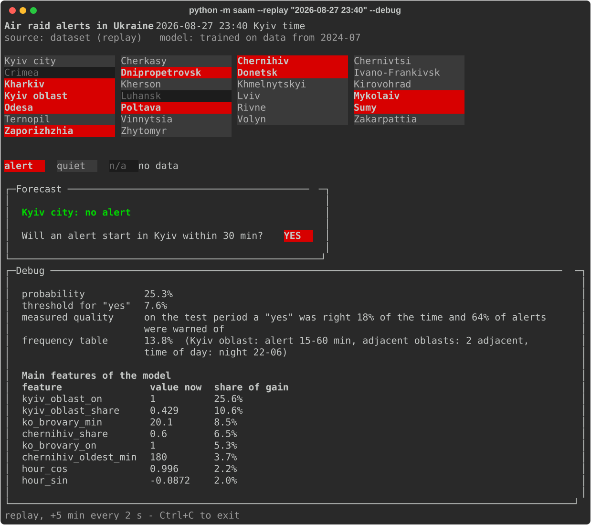

During a Kyiv alert the question changes to "will it end", and the measured weakness of that forecast is always shown under the answer (decision 22):

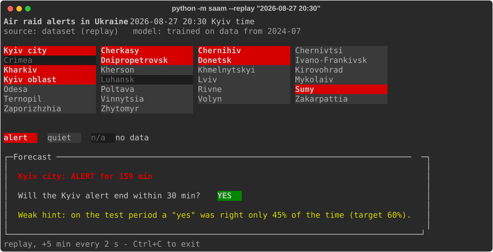

All regions are shown as a wall of equal bricks, Kyiv city first. Live data colours a brick red (missile threat) or yellow (drone threat); the dataset has no levels, so in replay an alert is simply red. Crimea is never reported by the sources used, and Luhansk oblast is absent from the dataset (permanent alert), so they are shown as "no data". If an update fails while the program is running, the last screen stays and the failure is shown under it.

The trained models are in `models/`. To rebuild everything from the CSV: `python -X utf8 scripts/final.py`. Tests: `pytest`.

Checked the way a reviewer would run it: a fresh clone into an empty folder, a new virtual environment, `pip install -r requirements.txt`, then `pytest` (31 passed) and the program in replay and live modes. Done on Windows with Python 3.11.9 only; Linux and macOS were not tried.

## Why Kyiv only

The chance of an alert in Kyiv depends strongly on the state of neighbouring oblasts (Chernihiv, Kyiv oblast and others). That gives the model a strong signal and keeps the task feasible in two days. The hypothesis is supported by [arXiv 2411.14625](https://arxiv.org/html/2411.14625v1): the state of neighbouring oblasts is the most important group of features. Our own analysis refines it: Kyiv oblast is the strong signal, Chernihiv on its own is a weak one (see "Exploratory analysis", question 2).

## Key decisions

| # | Decision | Why |
|---|---|---|
| 1 | Two separate tasks: alert "start" and alert "end" | A combined target "alert active in N min" is explained almost entirely by an alert simply continuing, which gives misleadingly high metrics |
| 2 | The forecast comes from LightGBM. The probabilistic algorithm (frequency table, decision 20) and the baselines are kept for comparison and explanation | LightGBM was chosen on validation, where it had the best PR-AUC and Brier score in both tasks and for both training periods. The test period did not confirm that it is better than the simple methods. On "start" its lead over a logistic regression on region flags is +1.8 points of PR-AUC in the default mode (95% interval −3.0 … +7.0) and +0.4 on full history (−5.5 … +5.9): the two cannot be told apart on this test. On "end", at the agreed threshold, its "yes" is less precise than that of the duration curve by 6.8 points (−12.3 … −1.6). See "Uncertainty of the test results". LightGBM stays because the choice was frozen before the test; what can be said in its favour is narrower than it looked: it uses all the features, including raions and "minutes since" values that are empty when a region is quiet, and it was never worse than the regression by a margin that the test could detect on "start". Cost: its answers are harder to explain than a table cell or a regression weight. A neural network was rejected at the planning stage: Kyiv has only ~2.3k alert starts and attack patterns drift |
| 3 | Historical data: `official_data_uk.csv` from [Vadimkin/ukrainian-air-raid-sirens-dataset](https://github.com/Vadimkin/ukrainian-air-raid-sirens-dataset) (MIT; attribution and licence text in [DATA_LICENSE.md](DATA_LICENSE.md)) | Official source, starts 2022-03-15, Kyiv city is a separate region. Volunteer data rejected as riskier |
| 4 | Aggregation to oblast: an oblast is under alert if **at least one** of its raions or hromadas is | The data mixes levels (oblast / raion / hromada), raion-level dominates from 2025. The rule gives one representation for all years |
| 5 | Alerts separated by a short pause are **not merged** | Merging would distort the data and the "start" target |
| 6 | Exact duplicate rows are removed by the loading code; the raw CSV in git is not modified | Reproducibility, and the raw file can always be checked against the original |
| 7 | Time: storage and all interval computations in **UTC**; hour of day and day of week in **Kyiv time** (`Europe/Kyiv`). Only the Kyiv hour is used as a feature | See "Time". Claude suggested also giving the model the Moscow hour (UTC+3 all year, no clock change), in case attacks are planned by Moscow time; the author chose the Kyiv hour alone |
| 8 | Live alerts: [ubilling.net.ua/aerialalerts](https://ubilling.net.ua/aerialalerts/) in `?raw` mode | No token; returns raions, start time (UTC) and alert level. alerts.in.ua rejected: token by application, may not arrive in time. A token for alerts.in.ua was obtained later, but ubilling stays the default: a key cannot be committed, and the jury must be able to run the program without one |
| 9 | `--replay <datetime>` mode: plays back history from the dataset | Fallback if the API is unavailable, and a way to demo the program on a real attack |
| 10 | Interface: console; all regions as a wall of equal coloured bricks, forecast below. No web app | A true ASCII outline of Ukraine was judged expensive and fragile from the start. A tile map placed by geography was built as a prototype and worked, but the author did not like how it looked and replaced it with a plain wall. Rendering is one function, so the swap touched nothing else |
| 11 | Dashboards: matplotlib figures in `reports/figures/`, embedded in this README; a `--debug` panel in the console | Needed for debugging and for describing the data analysis |
| 12 | Tests with pytest | The main risk is leaking the future into features; it gives falsely good metrics and is invisible to the eye |
| 13 | On top of the "at least one raion" flag, each oblast also gets: the number of raions under alert, minutes since its latest alert started, and separate flags for the raions of Kyiv oblast | EDA: the plain flag is saturated for frontline and northern oblasts (Chernihiv is under alert 60% of the time) and carries almost no signal there |
| 14 | Both training periods are kept and offered as modes of the program: "full history" and "from 2024-07-01". The default is "from 2024-07-01" | Validation does not settle the choice: for "end" the recent period is better (75.1% against 72.2%), for "start" the two are within noise (12.5% against 12.8%). The author expected the recent period to win but did not trust a choice made on such a margin. The default is the recent one because it is better on "end", equal on "start" and carries no hidden-clock risk. Both modes are reported on the test set; the default is fixed here, before the test is opened |
| 15 | Validation is widened to January–June 2026; once all choices are fixed, the final model is retrained on train + validation and only then tested | 139 alert starts in the original validation are too few to compare variants reliably; retraining returns the freshest data to the final model. See "Time split" |
| 16 | No region is removed from the feature set by hand, including Kharkiv, Donetsk and Dnipropetrovsk whose flags carry no signal (lift 1.0). The only filter is technical: a feature that takes a single value in the training period is not given to the model. Features are otherwise revisited only if the final result is unsatisfactory | The author's call: nothing is removed on the basis of one statistic about how useful a region looks. The technical filter was added after the baselines: Kharkiv is under alert 100% of the training time from mid-2024, the logistic regression put half of its intercept on that flag and broke once the flag started to vary. Such a feature cannot be learned from at all, whatever the region. Known risk that remains: with full-history training these flags can act as a hidden clock (Kharkiv was under alert 15% of the time in 2022). On the test the two training periods could not be told apart (see "Uncertainty of the test results"), so this risk did not show up as a measurable loss |
| 17 | Features and metrics are computed on a 5-minute grid | Five times fewer near-identical rows than a 1-minute grid with the same base rates (2.99% for "start"); one constant in `saam/config.py` |
| 18 | Features use only a snapshot of the current state: which alerts are active and when they started. Nothing about alerts that have already ended | The live API reports only active alerts. One candidate feature needed more: "minutes since the last Kyiv all-clear" (1.6–1.9× the base rate in the first hour after an all-clear). The API does not return that moment, so Claude proposed that the program remember it while running — and with that quietly assumed a long-running monitor, which had never been agreed. The author stopped it: nobody is expected to keep the program open for more than about half an hour at a stretch, so the program would rarely have seen the all-clear it needs, and building state tracking for one moderate feature would be wasted effort. The feature was dropped. This was the author's decision, not Claude's |
| 19 | "Minutes since an alert started" features of regions and raions are capped at 180 ("long ago"). The duration of the Kyiv city alert itself is not capped | Found on the first LightGBM run: for a region with a months-long alert the uncapped value is a day counter (one hromada alert in Kharkiv oblast lasted 604 days), and the model learned the calendar date from it. See "Model results" |
| 20 | The probabilistic algorithm is a table of conditional frequencies over three factors, smoothed towards the overall rate. "Start": state of Kyiv oblast (quiet / alert < 15 / 15–60 / > 60 min) × number of adjacent oblasts under alert (0, 1, 2, 3+) × time of day (4 parts), 64 cells. "End": how long the Kyiv alert has lasted (5 bands) × Kyiv oblast quiet or not × time of day | Every forecast can be read as a sentence ("night, oblast under alert for 20 min, three neighbours — 23%"), which suits the `--debug` panel. Naive Bayes over all flags was rejected: it assumes independent regions, and they are strongly linked |
| 21 | The yes / no answer is cautious by design, and the caution points in opposite directions for the two tasks. "Start": the threshold must catch at least **40%** of pre-alert moments (recall). "End": a "yes, it will end" must be right at least **60%** of the time (precision) | The author's deliberate choice: an extra warning is better than a missed alert, and a perfect result is not expected from a learning project. For "end" the dangerous mistake is the opposite one — promising an all-clear that does not come. The numbers were chosen from a measured trade-off, see "Operating point"; Claude had proposed 50% and 70% |
| 22 | The "end" forecast is shown as yes / no like the "start" forecast, although it missed its target on the test (precision 45% instead of 60%). Its measured precision is printed under the answer every time, in every output mode | The author's call: the binary answer was the agreed format from the first message, and one output format for both tasks keeps the program simple. Nothing is re-tuned on the test. At first the test precision was visible only with `--debug`; the author moved it under the answer, so that a user who never opens the debug panel still sees that this "yes" is a weak hint. This changes what is displayed, not the model, so the frozen protocol is intact |
| 23 | The program keeps running and refreshes the screen (about once a minute live; in steps in replay) instead of printing once and exiting | The author's request after seeing the first version: within a session the user should not have to start the program again to see fresh data. This does not turn the program into a monitor and does not conflict with decision 18: sessions are still short (nobody is expected to keep the program open for more than about half an hour at a stretch), so the argument against the dropped feature holds exactly as before |
| 24 | The trained models and thresholds are committed to the repository (`models/`, about 2 MB) | The author's call: the jury must be able to run the program right after cloning, without training anything. Library versions are pinned in `requirements.txt` because saved models are tied to them |

## Data

`official_data_uk.csv` is a snapshot; the last record is 2026-09-07 (the official file in the source repository has not been updated since).

- Columns: `oblast, raion, hromada, level, started_at, finished_at, source`.
- 299,275 rows, of which **185,430** are unique. 113,845 rows appear exactly twice.
- Duplicates are exact copies: all 7 columns match. Rows with the same place and start but a different end or level: 0. Duplicates exist up to 2026-01-25, none after.
- Empty `finished_at`: 0.
- Every timestamp carries the `+00:00` suffix.

To check the row and unique counts (should print `299275 185430`):

```bash
python -X utf8 -c "import csv;r=list(csv.reader(open('official_data_uk.csv',encoding='utf-8')))[1:];print(len(r),len(set(map(tuple,r))))"
```

### Kyiv after removing duplicates

| Year | Rows in file | Alerts | Hours under alert |
|---|---|---|---|
| 2022 (from 15 Mar) | 1,010 | 505 | 541 |
| 2023 | 602 | 301 | 397 |
| 2024 | 1,004 | 502 | 542 |
| 2025 | 1,022 | 511 | 740 |
| 2026 (to 7 Sep) | 503 | 448 | 405 |
| **Total** | 4,141 | **2,267** | |

Duration: median 38 min, 95th percentile 231 min, maximum 673 min. No overlapping intervals. 10 alerts are shorter than 2 min; 29 pairs of alerts are less than 5 min apart (not merged, decision 5).

## Exploratory analysis

Done on a 1-minute grid (2.36M points, 2022-03-15 … 2026-09-07) with [scripts/eda.py](scripts/eda.py); the full numeric output is in [reports/eda_output.txt](reports/eda_output.txt). "Recent" below means from 2025-07-01. The analysis was run to answer six questions that the plan depended on.

### 1. Do neighbours predict Kyiv, and how early?

Yes. The strongest signal is Kyiv oblast: when it is under alert and the city is not, a city alert starts within 30 min in 12.5% of cases against a 3.5% base rate (recent).

- In 63% of city alert starts Kyiv oblast was already under alert; in 51% for at least 10 min, in 35% for at least 30 min; the median is 36 min.
- 37% of city alerts start with no alert in Kyiv oblast — these cannot be caught from neighbours.

The 30-minute horizon is kept: it matches the typical lead.

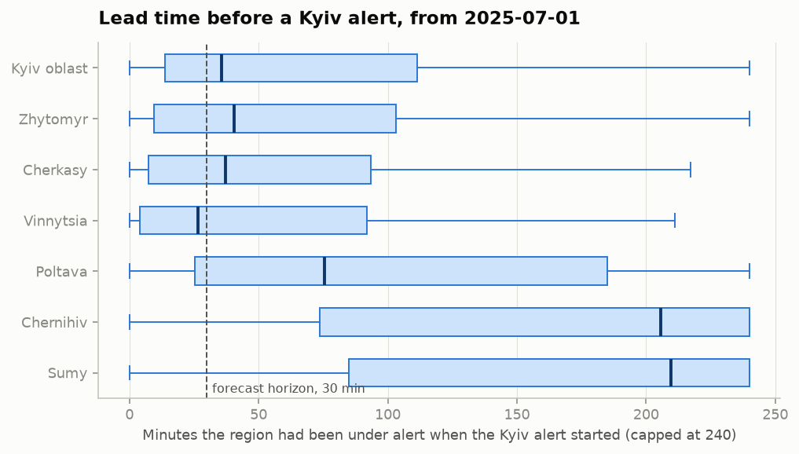

### 2. Which regions count as neighbours?

| Region | Share of time under alert | Precision | Lift | Recall |
|---|---|---|---|---|
| Kyiv oblast | 13% | 12.5% | 3.6× | 47% |
| Cherkasy | 8% | 11.0% | 3.1× | 26% |
| Zhytomyr | 5% | 8.7% | 2.5× | 13% |
| Poltava | 28% | 6.0% | 1.7× | 48% |
| Chernihiv | 60% | 4.7% | 1.3× | 81% |
| Sumy | 76% | 3.9% | 1.1× | 83% |
| Kharkiv, Donetsk, Dnipropetrovsk | 92–100% | ≈3.5% | 1.0× | 93–100% |

Recent period, Kyiv city quiet. Precision = P(city alert starts within 30 min | region under alert); recall = share of pre-alert minutes covered by the signal. Lift = precision divided by the 3.5% base rate.

Recall alone is misleading here: Kharkiv, Donetsk and Dnipropetrovsk reach 93–100% only because they are under alert almost all the time. Their lift of 1.0 means that knowing their state does not change the odds for Kyiv at all. They are kept as features anyway (decision 16).

Chernihiv, the motivating example of this project, gives 4.7% against a 3.5% base rate as a plain yes/no flag, because it is under alert most of the time. Western oblasts (Chernivtsi 12%, Vinnytsia 10%) are precise but rare: they switch on only during nationwide alerts, recall 2–6%. This is the reason for decision 13.

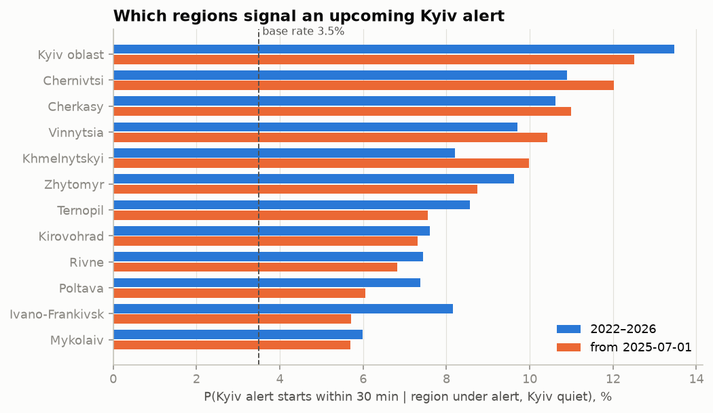

### 3. Did the move to raion-level alerts break the oblast flag?

Partly.

- Kyiv oblast: the share of time under alert jumped from 5.6% to 22.6% in the second half of 2024, while all its rows were still oblast-level. This is a real increase in attacks, not an aggregation effect. After the move to raions (2025) it stays at 17–26%.
- Chernihiv: here the effect is real — 28% → 55% → 68% right after the move.
- Kharkiv: 100% of the time from mid-2024 because of a single hromada-level alert that lasted 604 days.

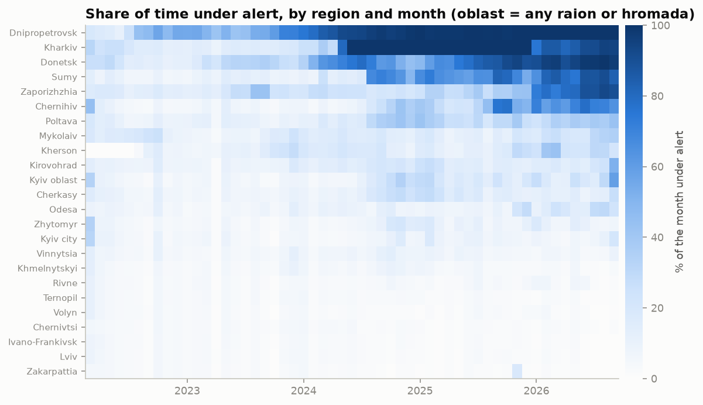

### 4. Is it worth training on 2022–2023?

The data drifts:

- 2023 is the quietest year (301 alerts, 4.6% of the time under alert).
- Median duration falls: 49 → 55 → 34 → 35 → 30 min (2022 → 2026).
- Share of alerts starting at night (22:00–06:00 Kyiv time): 31% in 2022, 48% in 2025, 39% in 2026.
- After 2 hours of alert the chance to end within 30 min was 36% in 2022–2024 and 22% in 2025–2026.

Analysis alone cannot settle this, hence decision 14.

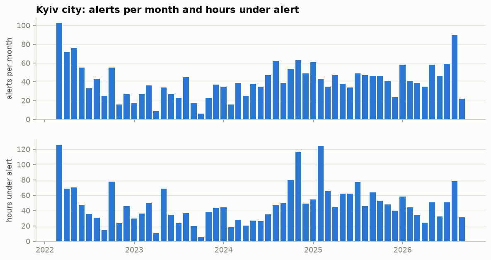
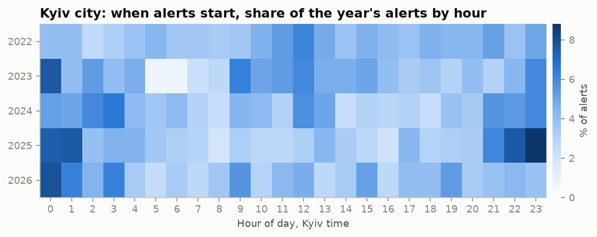
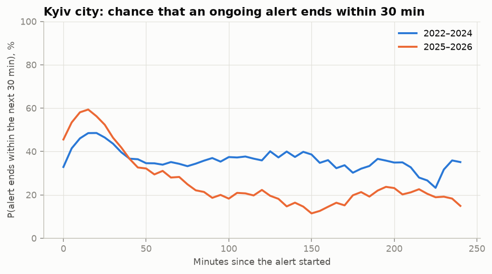

### 5. How rare is the event?

- "Start" task: 3.0% of quiet minutes are followed by an alert within 30 min. This is the PR-AUC of random guessing.
- "End" task: 37% of alert minutes are followed by an end within 30 min.

With the split planned before EDA:

| Part | Kyiv alert starts | "Start" base rate |
|---|---|---|
| Train (to March 2026) | 1,957 | 2.9% |
| Validation (April–June 2026) | 139 | 3.3% |
| Test (July – 6 September 2026) | 171 | 5.5% |

The test period is about twice as intense as training: August 2026 had 90 alerts, the most since March 2022. Validation is small, so a threshold picked on 139 events would be noisy — this led to decision 15.

### 6. Data quality across all regions

- 2 rows with zero duration (Odesa and Kharkiv oblasts, November 2025) — dropped by the loader, 185,428 rows remain.
- 451 rows shorter than 1 min; 897 longer than 24 h, almost all in Donetsk and Dnipropetrovsk oblasts.
- Overlapping intervals within the same raion or hromada: 0.
- Luhansk: 1 row; its permanent alert is not in the data, so the region is excluded.

## Time

The dataset is in UTC with a constant offset all year. Checked against known events: the mass strike of 2022-10-10 starts at 03:47 in the data, which is 06:47 Kyiv summer time.

The problem: Ukraine switches between UTC+2 (winter) and UTC+3 (summer), so the same UTC hour is a different hour for people. The data shows it: the peak of alert starts in Kyiv moves from 21:00 UTC in summer to 22:00–23:00 UTC in winter, while in Kyiv time it stays around midnight (2024–2026, small sample).

Options considered:

| Option | Idea | Verdict |
|---|---|---|
| **A** | Computations in UTC, calendar features in `Europe/Kyiv` | **chosen** |
| B | Convert the whole dataset to Kyiv time | The autumn hour 03:00–04:00 occurs twice, the spring one does not exist; an offset would have to be stored next to every timestamp |
| C | Everything in UTC + a "summer time" feature | Baselines cannot learn the shift, so the model comparison becomes unfair |
| D | Fixed offset all year | The hour is off by one for half of the year |

How A works: the time grid, region states, durations, lags and the target are computed in UTC, where a day is always 24 hours. For each grid point the Kyiv hour and day of week are computed separately with `zoneinfo`. On a switch night the grid stays regular; in autumn two neighbouring hours simply get the same label, and in spring one label is skipped.

No Kyiv alert in the dataset spans a switch moment (checked on all 9 switches); other oblasts were not checked.

Which clock to use for the hour of day was a separate choice. Russia does not change its clocks (Moscow is UTC+3 all year), so if attacks are planned by Moscow time, the Kyiv hour is off by one in winter. The small sample above points to Kyiv time. Claude suggested giving the model both hours and letting validation decide; the author chose the Kyiv hour alone, and the Moscow hour was never tried.

## Evaluation

**Metrics**

- PR-AUC — primary (classes are imbalanced).
- Brier score and calibration curve.
- Precision / recall / F1 at a threshold picked on validation; the yes / no answer comes from this threshold.
- Number of false "yes" per day. A false "yes" is an unbroken run of "yes" forecasts that is not followed by an alert.

The baseline and first model tables below use the threshold with the best F1, which was the working rule before the operating point was agreed (decision 21). The "Operating point" section gives the same models at the agreed thresholds.

**Baselines**

1. Climatology: frequency of an alert start by Kyiv hour × day of week.
2. Neighbour rule: "yes" if Kyiv oblast or an adjacent oblast (Chernihiv, Zhytomyr, Cherkasy, Poltava, Vinnytsia — the five Ukrainian oblasts that border it, [source](https://en.wikipedia.org/wiki/Kyiv_Oblast#Geography)) is under alert right now. Two variants are reported next to it: Kyiv oblast alone, and the number of these six regions under alert.
3. Logistic regression on the yes/no state of every region.

For the "end" task: the empirical duration curve — P(end within `H` min | alert has lasted `t` min).

**Time split** (no shuffling, gap ≥ `H` between parts)

| Part | Period | Kyiv alert starts |
|---|---|---|
| Train | 2022-03-15 or 2024-07-01 (decision 14) … 2025-12-31 | 1,819 or 825 |
| Validation | 2026-01-01 … 2026-06-30 | 277 |
| Final training (train + validation) | … 2026-06-30 | 2,096 or 1,102 |
| Test | 2026-07-01 … 2026-09-06 | 171 |

The split was changed after EDA. Options considered:

| Option | Idea | Verdict |
|---|---|---|
| 1 | Keep validation at April–June 2026 | Every choice rests on 139 events; a rough error of ±8 percentage points on recall makes the comparison of training periods unreliable |
| 2 | Widen validation to January–June 2026 | 277 events and both winter and summer in validation, but training loses the 138 freshest alert starts and a third of the raion-level data |
| **3** | Option 2, then retrain the final model on train + validation | **chosen**: reliable choices and the freshest data in the final model |
| 4 | Rolling validation over several periods | Most reliable, too much code and time for a two-day MVP |

Procedure: thresholds, hyperparameters, feature set and the training period are chosen on validation. They are then frozen, the model is retrained on train + validation with the same settings, and the test set is opened once.

Cost of option 3: the threshold is picked for a model trained on less data and may be slightly off after retraining; this cannot be checked on anything but the test set.

The test period is not moved even though it is unusually intense: choosing it to get a better number would be dishonest.

### Baseline results

Validation period, January–June 2026, 5-minute grid; produced by [scripts/baselines.py](scripts/baselines.py), full output in [reports/baselines_output.txt](reports/baselines_output.txt). The test period has not been touched. Thresholds are picked on the same validation data, so precision, recall and F1 are slightly optimistic, equally for every row.

**"Start" task** — 49,187 points, 1,611 positive, base rate 3.28%.

| Baseline | Trained on | PR-AUC | Precision | Recall | F1 | Says "yes" | False "yes" per day |
|---|---|---|---|---|---|---|---|
| Random | — | 3.2% | 3.3% | 91.9% | 6.4% | 91% of the time | 21.7 |
| Climatology | full history | 3.9% | 4.2% | 29.0% | 7.4% | 23% | 3.0 |
| Climatology | from 2024-07 | 3.9% | 4.7% | 28.2% | 8.0% | 20% | 1.5 |
| Rule: Kyiv oblast | — | 7.3% | 11.5% | 49.3% | 18.6% | 14% | 2.0 |
| Rule: Kyiv oblast or adjacent | — | 8.0% | 4.0% | 90.6% | 7.7% | 74% | 4.2 |
| Rule: at least 4 of the 6 neighbours | — | 8.0% | 13.4% | 22.1% | 16.7% | 5% | 1.2 |
| Logistic regression | full history | 9.7% | 14.7% | 33.0% | 20.3% | 7% | 2.0 |
| **Logistic regression** | **from 2024-07** | **11.3%** | 17.9% | 27.9% | **21.8%** | 5% | 1.5 |

What this shows:

- The bar is low: the best baseline has a PR-AUC of 11.3% and an F1 of 22%. The task is hard.
- Hour and day of week alone give almost nothing (3.9% against a 3.3% base rate). Forecasting from day and time only, an idea considered early on, would have produced exactly this.
- Adjacent oblasts matter as part of the picture, not as a switch. "Kyiv oblast or adjacent" catches 91% of alerts but says "yes" 74% of the time. Counting the neighbours instead of OR-ing them ranks better than Kyiv oblast alone (8.0% against 7.3%).
- Training from mid-2024 beats the full history for the logistic regression (11.3% against 9.7%), but only with the constant-feature filter of decision 16. Without it the recent variant scored 6.0%: the Kharkiv flag got a weight of −2.58 and the probability was inflated about 13 times whenever Kharkiv was not under alert (16% of the validation period).

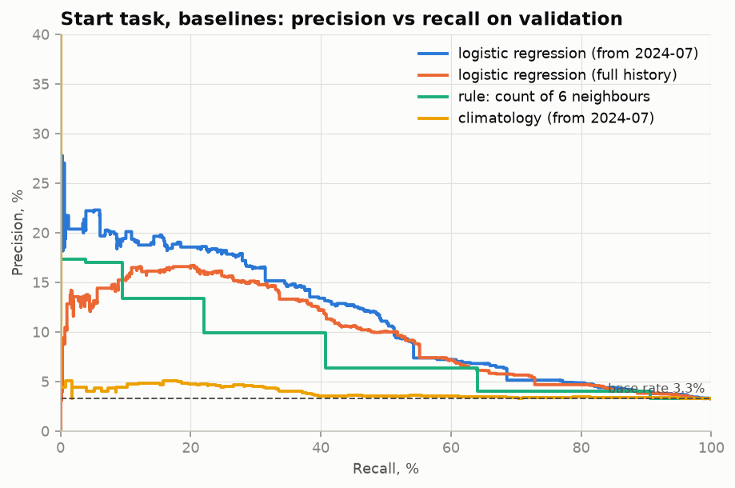
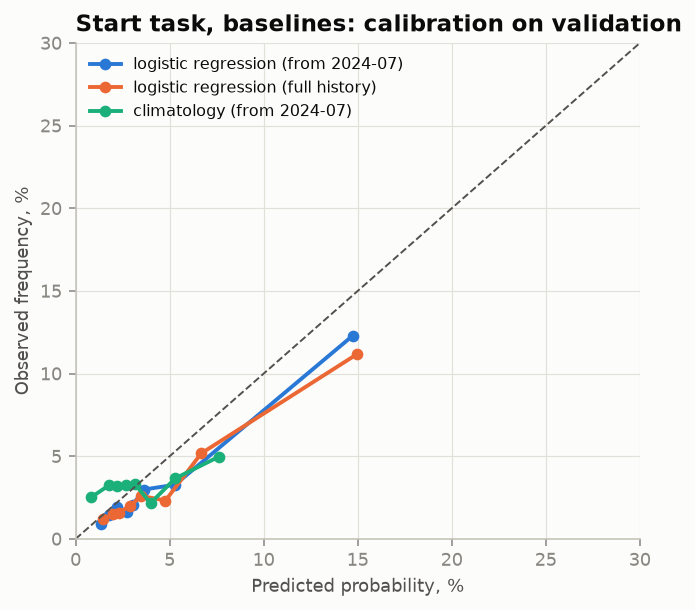

**"End" task** — 2,936 points, base rate 46.3%.

| Baseline | Trained on | PR-AUC | Brier | F1 |
|---|---|---|---|---|
| Always "yes" | — | 46.4% | — | 63.4% |
| Duration curve | full history | 60.6% | 0.2355 | 66.9% |
| Duration curve | from 2024-07 | 60.8% | 0.2309 | 67.0% |

The duration curve ranks clearly better than chance but barely beats "always yes" on F1. With almost half of the points positive, F1 is a weak criterion for this task; PR-AUC and Brier are the ones to watch.

For reference, the base rate of the "start" task grows with the horizon: 3.9% at 30 min, 7.4% at 60 min and 13.6% at 120 min (2026).

### Model results

First versions, validation period, same conditions as the baselines; produced by [scripts/models.py](scripts/models.py). LightGBM ran with the settings it had before tuning (15 leaves, minimum leaf 200). [saam/models.py](saam/models.py) now holds the tuned settings and [reports/models_output.txt](reports/models_output.txt) was regenerated with them, so that file matches the "after" numbers in "Tuning", not the tables of this section.

**"Start" task** (base rate 3.28%)

| Model | Trained on | PR-AUC | Brier | Precision | Recall | F1 | False "yes" per day |
|---|---|---|---|---|---|---|---|
| Best baseline (logistic regression) | full history | 9.7% | 0.0310 | 14.7% | 33.0% | 20.3% | 2.0 |
| Frequency table | full history | 10.0% | 0.0306 | 13.7% | 41.8% | 20.6% | 2.3 |
| **LightGBM** | full history | **12.8%** | 0.0302 | 20.9% | 29.4% | **24.4%** | 2.1 |
| Best baseline (logistic regression) | from 2024-07 | 11.3% | 0.0304 | 17.9% | 27.9% | 21.8% | 1.5 |
| Frequency table | from 2024-07 | 9.9% | 0.0305 | 13.8% | 42.9% | 20.8% | 2.1 |
| LightGBM | from 2024-07 | 12.5% | 0.0302 | 19.6% | 30.8% | 23.9% | 2.4 |

**"End" task** (base rate 46.3%)

| Model | Trained on | PR-AUC | Brier | F1 |
|---|---|---|---|---|
| Baseline (duration curve) | full history | 60.6% | 0.2355 | 66.9% |
| Frequency table | full history | 63.4% | 0.2298 | 67.3% |
| LightGBM | full history | 72.2% | 0.2098 | 69.8% |
| Baseline (duration curve) | from 2024-07 | 60.8% | 0.2309 | 67.0% |
| Frequency table | from 2024-07 | 64.5% | 0.2238 | 67.3% |
| **LightGBM** | from 2024-07 | **75.1%** | **0.1940** | **70.9%** |

What this shows:

- **"Start" is hard for every method.** On validation LightGBM is the best, but its lead over the best baseline is modest: PR-AUC 12.5–12.8% against 11.3%, F1 24% against 22%.
- **The frequency table does not beat the best baseline on "start"** (10.0% against 11.3%): three factors are too few. It catches more alerts (recall 42–43%) at lower precision. On "end" it is ahead of the duration curve but far behind LightGBM.
- **"End" is where LightGBM clearly wins on validation**: PR-AUC 75% against 61%. The test did not confirm this, see "Test results".
- **Training period (decision 14):** for "end" the recent period is better (75.1% against 72.2%); for "start" the two are within noise of each other (12.5% against 12.8%). Both are kept as modes of the program.

What the models look at (LightGBM, share of total gain):

- "Start": Kyiv oblast and its raions give 29–38%, the calendar about 11%, all other regions together about half.
- "End": the top features are how recently a new alert started in Chernihiv and Poltava oblasts. The duration of the Kyiv alert itself gives only 2–4%: the model judges the end by whether the attack is still unfolding at the neighbours.

The most and least likely cells of the "start" frequency table (trained from 2024-07; full tables in [reports/frequency_table_start.csv](reports/frequency_table_start.csv) and [reports/frequency_table_end.csv](reports/frequency_table_end.csv)):

| Kyiv oblast | Adjacent oblasts under alert | Time of day | Training points | Chance of a Kyiv alert within 30 min |
|---|---|---|---|---|
| alert 15–60 min | 3+ | night | 1,823 | 23.3% |
| alert 15–60 min | 3+ | evening | 425 | 19.9% |
| alert < 15 min | 3+ | night | 595 | 18.7% |
| quiet | 0 | morning | 24,122 | 1.3% |
| quiet | 0 | night | 15,945 | 1.1% |

**The hidden clock (decision 19).** On the first run LightGBM lost to the logistic regression on the recent period (10.4% against 11.3%). Its third most important feature was "minutes since the oldest active alert in Kharkiv oblast started" — a counter of days since May 2024. Three variants were compared on validation: as is, minutes capped at 180, and capped with the "oldest" features removed. The cap value was taken from EDA (neighbours lead Kyiv by tens of minutes), not searched for.

| "Start" task, LightGBM | Full history: PR-AUC / Brier | From 2024-07: PR-AUC / Brier |
|---|---|---|
| Uncapped | 11.3% / 0.0319 | 10.4% / 0.0366 |
| Capped at 180 min | 12.8% / 0.0302 | 12.5% / 0.0302 |

Removing the "oldest" features on top of the cap gave nothing and was not adopted.

### Operating point

How the yes / no answer is cut out of the probability (decision 21). All numbers are from validation, LightGBM with the settings it had before tuning, mode "from 2024-07"; 277 Kyiv alerts in the period.

**"Start": the price of each recall level**

| Recall by moments | Precision of "yes" | Says "yes" (share of quiet time) | False "yes" per day | Alerts warned |
|---|---|---|---|---|
| 30% | 19.5% | 5% | 2.3 | 47% |
| **40% (chosen)** | **15.0%** | **9%** | **3.6** | **55%** |
| 50% | 9.1% | 18% | 8.3 | 66% |
| 60% | 6.3% | 31% | 12.5 | 75% |
| 70% | 5.0% | 46% | 15.3 | 87% |
| 80% | 4.5% | 59% | 15.6 | 92% |

"Recall by moments" is the share of 5-minute moments before an alert at which the program said "yes". "Alerts warned" is the share of alerts preceded by at least one "yes" within 30 minutes — closer to what a user experiences, and always higher. For warned alerts the "yes" is typically already on at the start of the 30-minute window (median 25–27 min before the alert).

The price rises steeply: beyond 60–70% the program says "yes" a third to a half of the time and turns into the "almost always yes" seen in the neighbour rule. At the chosen 40% it warns of a little over half of the alerts, says "yes" 9% of the quiet time, and about one "yes" in seven is right.

**"End": the price of each precision level**

| Precision of "yes, it will end" | Real endings caught | Says "yes" (share of alert time) |
|---|---|---|
| **60% (chosen)** | **86%** | **67%** |
| 70% | 64% | 42% |
| 80% | 43% | 25% |
| 90% | 20% | 10% |

At the chosen 60%, four in ten promises of an all-clear within 30 minutes are wrong. The base rate is 46%, so the gain over saying "yes" always is 14 points of precision.

**All models at the agreed operating point**

| "Start", recall ≥ 40% | Trained on | Precision | Says "yes" | False "yes" per day | Alerts warned |
|---|---|---|---|---|---|
| Best baseline (logistic regression) | full history | 12.2% | 10.7% | 2.8 | 54% |
| Frequency table | full history | 13.7% | 9.6% | 2.3 | 53% |
| LightGBM | full history | 16.0% | 8.2% | 3.2 | 57% |
| Best baseline (logistic regression) | from 2024-07 | 13.4% | 9.9% | 2.2 | 53% |
| Frequency table | from 2024-07 | 13.6% | 9.7% | 2.2 | 53% |
| LightGBM | from 2024-07 | 15.0% | 8.8% | 3.6 | 55% |

| "End", precision ≥ 60% | Trained on | Real endings caught | Says "yes" |
|---|---|---|---|
| Baseline (duration curve) | full history | 71% | 54% |
| Frequency table | full history | 68% | 51% |
| LightGBM | full history | 81% | 63% |
| Baseline (duration curve) | from 2024-07 | 71% | 54% |
| Frequency table | from 2024-07 | 66% | 49% |
| LightGBM | from 2024-07 | 86% | 67% |

LightGBM is the most precise at the same recall and says "yes" for the least time, but its "yes" comes in more separate episodes, so it has more false episodes per day than the simpler methods (3.2–3.6 against 2.2–2.8).

The thresholds are picked on validation. The test period is more intense, so the actual recall and precision there may differ from 40% and 60%.

### Tuning

A small search over LightGBM settings on validation ([scripts/tune.py](scripts/tune.py), output in [reports/tuning_output.txt](reports/tuning_output.txt) and [reports/tuning.csv](reports/tuning.csv)): 20 random combinations of the number of trees (150 / 300 / 600), learning rate (0.02 / 0.05 / 0.1), tree size (7 / 15 / 31 leaves) and minimum leaf size (100 / 300 / 1000), for each of the four models.

**How much is noise.** The first settings were refitted with 5 random seeds. The seed alone moves the "start" PR-AUC by about ±0.5 percentage points (12.3–13.5% for full history, 11.8–13.3% for the recent period). This confirms that the earlier 12.5% against 12.8% between the two training periods was noise, and it sets the bar for any claimed improvement. With 20 candidates the best one is expected to look about two such deviations better by luck alone.

**What was adopted.** Not the best candidate of each model, but one setting for all four: 7 leaves instead of 15 and a minimum leaf of 300 instead of 200 — smaller trees. It has the best average rank across the four models and is never the winner by a lucky margin in just one of them. Checked over 5 seeds each:

| Model | PR-AUC before | PR-AUC after | At the operating point, before → after |
|---|---|---|---|
| "Start", full history | 12.9% ± 0.5 | 13.6% ± 0.4 | precision 15.4% → 15.4% |
| "Start", from 2024-07 | 12.6% ± 0.6 | 14.1% ± 0.4 | precision 14.9% → 15.5% |
| "End", full history | 72.6% ± 0.4 | 72.4% ± 0.3 | recall 82.0% → 85.2% |
| "End", from 2024-07 | 75.2% ± 0.2 | 76.0% ± 0.2 | recall 86.2% → 87.9% |

The gain is clear for the default mode (from 2024-07): the new setting beats the best seed of the old one in 5 runs out of 5 in both tasks. For full history it is within noise. At the "start" operating point almost nothing changes: the ranking improved mostly in parts of the curve away from recall 40%. So tuning made the probabilities somewhat better and the yes / no answer barely different.

What the search also showed: large trees with many boosting rounds are the worst (PR-AUC down to 8–10% on "start") — the model memorises the training period.

### Frozen before the test

Everything that affects the test result was fixed, and committed, before the test period was opened. Nothing in this list is changed afterwards.

1. Features: 112, region minutes capped at 180 (decisions 13, 18, 19).
2. Model: LightGBM with the settings from "Tuning". The final model is the average of 5 models that differ only in the random seed — this removes the ±0.5 points of seed noise found during tuning.
3. Modes: "from 2024-07" (default) and "full history" (decision 14).
4. Thresholds: recall ≥ 40% for "start", precision ≥ 60% for "end" (decision 21). Their values are computed on validation for models trained on the training period only, and are not adjusted on the test.
5. Final training on train + validation, up to 30 June 2026 (decision 15).
6. Test: 1 July – 6 September 2026, opened once. Both modes, the baselines and the frequency table are reported, each with a threshold picked on validation by the same rule.

### Test results

One pass over 1 July – 6 September 2026 with the frozen protocol; produced by [scripts/final.py](scripts/final.py), full output in [reports/final_output.txt](reports/final_output.txt). 171 Kyiv alerts in the period. Nothing in the models, features or thresholds was changed after seeing these numbers; what came later concerns only what the program displays and how the results are described.

**"Start": will a Kyiv alert start within 30 minutes** — 17,664 points, base rate 5.47% (validation: 3.28%)

| Model | Mode | PR-AUC | Precision | Recall | Says "yes" | False "yes" per day | Alerts warned |
|---|---|---|---|---|---|---|---|
| Baseline: climatology | from 2024-07 | 7.4% | 6.8% | 42.1% | 33.7% | 2.2 | 44% |
| Baseline: logistic regression | from 2024-07 | 17.1% | 13.8% | 39.3% | 15.6% | 2.3 | 61% |
| Frequency table | from 2024-07 | 15.7% | 23.6% | 34.5% | 8.0% | 2.2 | 56% |
| **LightGBM (default mode)** | from 2024-07 | 18.9% | 17.9% | 38.4% | 11.7% | 2.4 | **64%** |
| Baseline: logistic regression | full history | 19.4% | 14.5% | 43.2% | 16.3% | 2.3 | 63% |
| Frequency table | full history | 15.8% | 23.7% | 35.6% | 8.2% | 2.2 | 57% |
| LightGBM | full history | **19.8%** | 26.6% | 35.7% | 7.3% | 2.6 | 63% |

Reference: saying "yes" always gives 5.5% precision.

- **The forecast held up.** In the default mode the program warned of 64% of the alerts, said "yes" 11.7% of the quiet time, and about one "yes" in six was right — more than three times the base rate. Recall came out at 38.4% against the 40% target: the threshold transferred well.
- **LightGBM is the best by PR-AUC, but not by much.** Its lead over the logistic regression is 1.8 points in the default mode and 0.4 points on full history. The bootstrap below shows that a difference of this size is well within chance, so LightGBM cannot be claimed to be better than the regression on new data. Its advantage on validation (14.3% against 11.3%) shrank on the test.
- **The default mode was not the better one on the test** (18.9% against 19.8%). It was named before the test and stays the default; the two modes cannot be told apart on this test (−0.9 points, 95% interval −2.4 … +1.2).
- **The frequency table does better than expected at its threshold**: the highest precision among the simple methods (23.6%) at a somewhat lower recall.
- The probabilities are too low on average (3.6% predicted against 5.5% observed): the test period is more intense than anything the models were trained on.

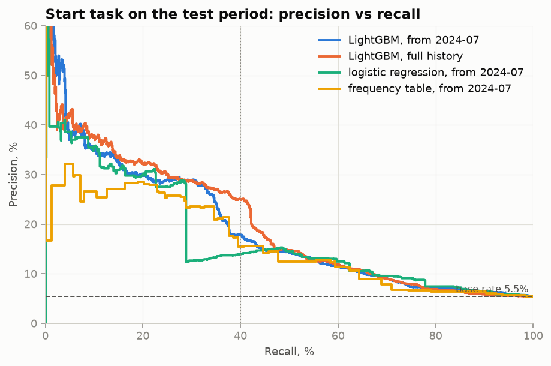
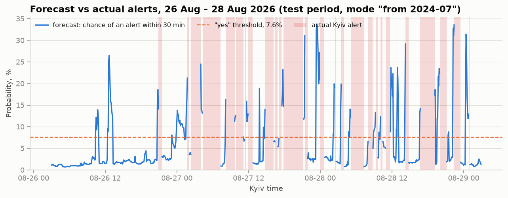

**"End": will the current alert end within 30 minutes** — 1,915 points, base rate 41.1% (validation: 46.3%)

| Model | Mode | PR-AUC | Brier | Precision of "yes" | Real endings caught | Says "yes" |
|---|---|---|---|---|---|---|
| Baseline: duration curve | from 2024-07 | 50.9% | 0.233 | 52.0% | 62% | 49% |
| Frequency table | from 2024-07 | 50.7% | 0.239 | 47.4% | 72% | 62% |
| **LightGBM (default mode)** | from 2024-07 | 55.9% | 0.252 | **45.2%** | 97% | 88% |
| Baseline: duration curve | full history | 51.4% | 0.230 | 52.0% | 62% | 49% |
| Frequency table | full history | 49.1% | 0.234 | 46.2% | 68% | 60% |
| LightGBM | full history | 58.8% | 0.228 | 44.8% | 96% | 88% |

- **The target was not met.** The agreed rule was that a "yes, it will end" is right at least 60% of the time. On the test it was right 45% of the time, and the program said "yes" during 88% of alert time. At this threshold the forecast is barely better than always saying "yes" (41%), and no method reached 60%.
- **The model's quality dropped, not only the threshold.** PR-AUC fell from 76% on validation to 56% on the test. In the default mode the Brier score (0.252) is worse than that of the simple duration curve (0.233) and worse than predicting the base rate for every point (0.242). LightGBM still ranks moments better than the baselines (PR-AUC 56–59% against 51%), but its probabilities are too high: 55% predicted on average against 41% observed.
- **Diagnostics after the fact** (they explain the result and change nothing): the model that was not retrained on validation gives the same 46% precision, so the final retraining is not the cause. Even with hindsight, 60% precision is reachable on the test only for 20–40% of the endings. Alert durations in the test period look like those in validation (median 30 min against 29), so the change is in how the neighbours' state relates to the end of a Kyiv alert.
- **What follows for the program (decision 22):** the "end" answer stays a yes / no, as agreed at the start. Claude proposed showing only the probability; the author kept the binary answer. The measured precision of 45% is stated here and printed under the answer every time the "end" question is shown, so the weakness is in front of the user rather than hidden.

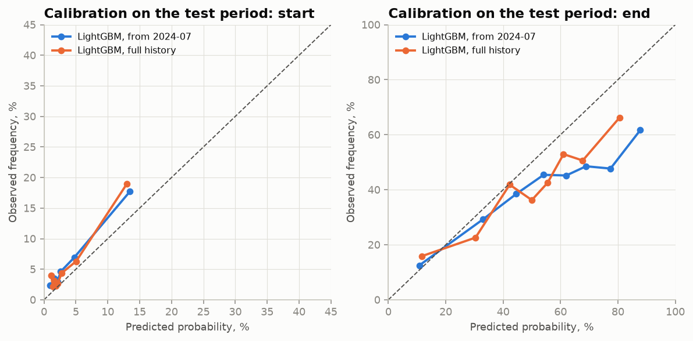

### Uncertainty of the test results

One test period of 68 days with 171 alerts; neighbouring 5-minute points are near-copies, so the effective sample is much smaller than the point counts suggest. To see how much of the differences could be chance, the test forecasts were resampled with a paired block bootstrap: [scripts/bootstrap.py](scripts/bootstrap.py), output in [reports/bootstrap_output.txt](reports/bootstrap_output.txt) and [reports/bootstrap.csv](reports/bootstrap.csv).

Method: the period is cut into day-long blocks starting at 12:00 Kyiv time, so that a night attack stays in one block (69 blocks for "start" — the noon boundary splits the 68 days into 69 pieces — and 54 with a Kyiv alert for "end"). Blocks are drawn with replacement 2,000 times, and both models of a comparison are scored on the same draw. The interval is the 2.5th to 97.5th percentile. The rule was set before the run: if the interval of a difference contains zero, the two are reported as not distinguishable on this test.

Nothing was tuned or re-chosen. LightGBM was loaded from `models/`. The two baselines had not been saved, so they were fitted again by the same deterministic procedure; the script checks that every reproduced metric equals the published one and stops otherwise.

| "Start", PR-AUC | Value | 95% interval | Verdict |
|---|---|---|---|
| LightGBM, from 2024-07 | 18.9% | 13.0 … 26.7 | |
| Logistic regression, from 2024-07 | 17.1% | 11.2 … 24.5 | |
| LightGBM − logistic regression, from 2024-07 | +1.8 | −3.0 … +7.0 | not distinguishable |
| LightGBM, full history | 19.8% | 13.7 … 27.6 | |
| Logistic regression, full history | 19.4% | 12.3 … 28.2 | |
| LightGBM − logistic regression, full history | +0.4 | −5.5 … +5.9 | not distinguishable |
| LightGBM: from 2024-07 − full history | −0.9 | −2.4 … +1.2 | not distinguishable |
| Logistic regression: from 2024-07 − full history | −2.3 | −5.2 … +0.5 | not distinguishable |

| "End", precision of "yes" at the frozen thresholds | Value | 95% interval | Verdict |
|---|---|---|---|
| LightGBM, from 2024-07 | 45.2% | 38.4 … 53.5 | the 60% target is outside the interval |
| Duration curve, from 2024-07 | 52.0% | 44.0 … 60.0 | |
| LightGBM − duration curve, from 2024-07 | −6.8 | −12.3 … −1.6 | LightGBM is worse |
| LightGBM, full history | 44.8% | 38.0 … 53.1 | the 60% target is outside the interval |
| LightGBM − duration curve, full history | −7.2 | −12.5 … −2.0 | LightGBM is worse |
| LightGBM: from 2024-07 − full history | +0.4 | −0.0 … +0.9 | not distinguishable |
| Always "yes" (base rate) | 41.1% | 33.7 … 50.2 | |
| LightGBM, from 2024-07 − always "yes" | +4.1 | +0.3 … +9.6 | slightly better than always "yes" |

What this says:

- **"Start": both LightGBM and the logistic regression are clearly useful** (even the lower ends, 11–14%, are more than twice the 5.5% base rate), **but they cannot be ranked.** The same holds for the two training periods. The intervals are wide: the measured PR-AUC of 18.9% could plausibly have been anywhere from 13% to 27%.
- **"End": the miss is real, not bad luck.** The whole interval for LightGBM lies below the 60% target, and LightGBM's "yes" is less precise than the duration curve's. The two say "yes" at very different rates (88% against 49% of alert time), so this compares the two answers the program could give, not the models at equal recall.

What the method does not show: the spread from retraining the models, and whether a future period will behave like this one. The days are also not fully independent — attack waves last several days — so the intervals are more likely too narrow than too wide.

The validation period was used for many choices (feature cap, settings, thresholds), so validation numbers are optimistic; the gap between validation and test on "end" shows by how much they can be.

## Known limitations

- **Data gap.** History ends on 2026-09-07; there is more than a month without data between training and live use.
- **Yellow and red alerts.** Since September 2026 alerts carry levels (yellow — drones, red — missiles); ubilling returns them. The model is trained on data without levels, so the live forecast is outside the training distribution and there is nothing to measure its quality on under the new regime. The introduction date (6 September) comes from a third-party project, not an official source.
- **Change of granularity.** Raion-level data barely exists before mid-2025, so raion-based features (decision 13) are degenerate in older years. For Chernihiv the oblast flag fires about twice as often after the move to raions.
- **Not all alerts are predictable from neighbours.** 37% of city alerts start with no alert in Kyiv oblast.
- **The "end" forecast is a weak hint.** On the test period its "yes" was right 45% of the time against a 60% target; the program says so under the answer.
- **The live source is volunteer-run.** Ubilling proxies third-party sources that do not always agree with each other; not for safety decisions.

## Corrections log

Who corrected whom and what changed.

| Who | Before | After |
|---|---|---|
| Claude → author | The choice was "probabilistic algorithm or neural network" | A middle option was added — gradient boosting; the neural network was rejected |
| Claude → author | If the API is unavailable, forecast from day and time only, without the current state | A token-free API (ubilling) was found; the current state of neighbours stays the main signal |
| Author → Claude | Claude wrote that the dataset is updated daily | Only the volunteer data is updated daily; the official file stopped on 2026-09-07. The test period was shortened to 2026-09-06 |
| Author → Claude | Claude suggested not committing the CSV | The CSV is committed to the repository |
| Claude → Claude | "Before December 2025 alerts were oblast-level" | Hromada-level rows exist from 2022, the move to raions happened during 2025 |
| Claude, confirmed by author | Suspicion: 1,010 alerts in Kyiv in 2022 is too many | Exact duplicates found across the whole file; the real count is 505 |
| Author → Claude | Claude suggested giving the model two hour-of-day features, Kyiv and Moscow time, and comparing them | The author chose the Kyiv hour alone (decision 7); the Moscow hour was never tried |
| Author, verified by Claude | Suspicion: time in the dataset is UTC and summer time will cause a problem | Confirmed; option A chosen |
| Claude → Claude | Argument against option B: alerts spanning a switch would get a wrong duration | No Kyiv alert spans a switch; only the code-complexity argument remains |
| Author → Claude | Claude wrote the README in Ukrainian | The whole project is in English |
| Claude → Claude | Expected the move to raion-level alerts in 2025 to inflate the oblast flag everywhere | For Kyiv oblast the jump happened in 2024 on oblast-level rows and is real; the inflation is confirmed only for Chernihiv |
| Data → both | Chernihiv was the motivating example of a predictive neighbour; Claude listed the adjacent oblasts from memory | As a yes/no flag Chernihiv is barely above the base rate; Kyiv oblast, Cherkasy and Zhytomyr are the informative ones. Extra features added (decision 13) |
| Author → author | The author leaned towards training only on data from mid-2024, where EDA shows the change | Not taken on faith: full history and mid-2024 are compared on validation (decision 14) |
| Claude → Claude | Claude read the author's "from 2024" as January 2024 and proposed a third variant | The author meant mid-2024; two variants are compared, not three |
| Claude → Claude | The split with a 3-month validation, proposed before the data was examined | Validation widened to 6 months with a final retraining (decision 15), after the author asked for the consequences of each option |
| Author → Claude | The EDA table showed 93–100% recall for Kharkiv, Donetsk and Dnipropetrovsk without saying that it means nothing | The author spotted that these regions are simply always under alert; a lift column and an explanation were added |
| Author → Claude | Claude proposed removing the three regions from the features because their lift is 1.0 | Rejected by the author: they stay, and features are changed only if the final result is unsatisfactory (decision 16) |
| Claude → Claude | Assumed ubilling would report when the last Kyiv alert ended | Checked once Kyiv was quiet: no mode and no source returns it |
| Author → Claude | Claude proposed keeping the "minutes since the last all-clear" feature by having the program remember the all-clear moment while it runs. In doing so Claude decided on its own, without asking, that the program is a long-running monitor | The author stopped it before any code was written: nobody is expected to keep the program open for more than about half an hour at a stretch, so the feature would be wasted effort. It was removed (decision 18) |
| Author → Claude | Claude proposed reducing the neighbour rule to Kyiv oblast alone, because Chernihiv is under alert most of the time | The author insisted that adjacent oblasts matter. Both variants were measured: as an OR-switch the adjacent oblasts are useless ("yes" 74% of the time), as a count they add information |
| Claude → Claude | "A flag that is almost always on is harmless for a logistic regression, it gets a weight near zero" | Wrong: the Kharkiv flag, constant in the recent training period, got a weight of −2.58 and halved the PR-AUC. The filter in decision 16 was added |
| Author + Claude | Decision 16 kept every region; the baselines then showed that one of those flags (Kharkiv) breaks the logistic regression on the recent period | Regions are still not removed by hand. The author accepted a narrow technical filter — drop a feature that is constant in the training period — and it was merged into decision 16 |
| Claude → Claude | The feature "minutes since the oldest active alert started", added by Claude under decision 13 | For Kharkiv it turned out to be a day counter — the same hidden clock Claude had warned about for flags. Capped at 180 min (decision 19); the author approved after seeing that the gain is modest but real |
| Claude → Claude | Expected the frequency table to land between the baseline and LightGBM | On "start" it is below the best baseline (10.0% against 11.3%) |
| Author → Claude | Claude proposed fixing the training period to "from 2024-07" for both tasks | The author did not trust a choice made on a margin within noise and kept both periods as modes of the program. Claude added one condition: the default mode is named before the test set is opened, so that it is not picked by its test score |
| Author → Claude | Thresholds were picked by the best F1, a formal rule Claude used by default | The author set the principle — better an extra warning than a missed alert — and chose recall 40% for "start" and precision 60% for "end" from the measured trade-off; Claude had suggested 50% and 70% |
| Claude → author | "Better to warn once more" was stated for the program as a whole | For "end" the cautious direction is the opposite: the dangerous mistake is a false promise of an all-clear, so the constraint there is on precision, not recall |
| Claude → Claude | Compared training periods and settings by a single run each | Refitting with 5 seeds showed ±0.5 points of pure chance on "start"; from then on settings are compared over several seeds, and one shared setting was adopted instead of four separate winners |
| Test → both | On validation the "end" model looked like the clear success of the project (PR-AUC 76%, 88% of endings caught at 60% precision) | On the test it missed its target: precision 45% instead of 60%, Brier score worse than the simple duration curve. Reported as is; nothing was re-tuned after the test |
| Test → Claude | Claude chose "from 2024-07" as the default mode and LightGBM as clearly the best model on the strength of validation | On the test the full-history mode was slightly ahead on "start", and the logistic regression came within 0.4–1.8 points of LightGBM. Both choices stay as frozen, with the weaker evidence stated |
| Author → Claude | After the test Claude proposed showing only a probability for "end", without yes / no | The author kept yes / no, as decided at the start (decision 22) |
| Author → Claude | Claude built a tile map of Ukraine placed by geography; it worked on the first prototype | The author did not like how it looked and replaced it with a plain wall of regions (decision 10) |
| Author → Claude | The 45% test precision of the "end" forecast was shown only with `--debug` | The author moved it under the answer in every output mode (decision 22): a display change, the model is untouched |
| Author → Claude | The debug panel listed "main features of the model" next to a forecast, which read as the reasons for that forecast | It is the model's global importance by gain, the same for every forecast; renamed and labelled as such at the author's request |
| Author → Claude | The list of oblasts adjacent to Kyiv oblast was written by Claude from memory and never checked | Checked against a source at the author's request: Zhytomyr, Vinnytsia, Cherkasy, Poltava and Chernihiv — the list was right, nothing changes in the baselines or the frequency table |
| Author → Claude | README still said "shows a map", counted 23 tests, and a docstring said the program is "not left running" | The author listed the stale places; Claude re-read the whole README against the code and fixed these and others (regenerated output files that no longer matched their tables, the section order) |
| Author → Claude | The test results were reported as point values; README said that no confidence intervals had been computed | The author asked for a resampling of the test forecasts and approved the method before any code was written. Result: LightGBM and the logistic regression cannot be told apart on "start"; the miss on "end" is real |
| Author → Claude | Decision 2 said "Measured, not assumed" about LightGBM's advantage, citing validation only | Rewritten from the bootstrap: the advantage was not confirmed on the test (+1.8 points, interval −3.0 … +7.0), and on "end" LightGBM's answer is worse than the baseline's |
| Author → Claude | The summary and this log credited the author with finding the duplicate rows | The author pointed out that Claude had raised the suspicion and found the duplicates, and that the author had only confirmed it. The log row now reads "Claude, confirmed by author", and the summary lists the UTC and summer-time issue, which the author raised unprompted |
| Author → Claude | After the program was made to refresh itself (decision 23), Claude wrote that this "reverses the assumption behind decision 18" and called it a contradiction. README then gave "the program is not a monitor" as the reason the all-clear feature was dropped | The author corrected the record: the reason was never the word "monitor" but the length of a session — about half an hour at most — which refreshing the screen does not change. Decisions 18 and 23 and the extensions list were rewritten; there is no contradiction between them |
| Author → Claude | Two decisions made by the author were missing from the decisions table: the Kyiv hour alone as a feature, and committing the trained models | Added to decision 7 and as decision 24 after the author asked for a check of decisions that had been left out |

## Stack

Python 3.11 · pandas · numpy · scikit-learn · lightgbm · joblib · matplotlib · rich · requests · pytest (versions pinned in `requirements.txt`)

## Plan

1. ~~EDA~~ — done, see "Exploratory analysis".
2. ~~Data loading and cleaning, time grid, features, target + leak tests~~ — done: 112 features; the test suite has 31 tests by now.
3. ~~Baselines and metrics~~ — done, see "Baseline results".
4. ~~Probabilistic algorithm and LightGBM, comparison~~ — done, see "Model results", "Tuning" and "Test results".
5. ~~Ubilling client, `--replay` mode~~ — done, see "How to run".
6. ~~Console interface: regions, forecast, `--debug` panel~~ — done, see "How to run".

Possible extensions:

- Use the alerts.in.ua history endpoint (last month only) for a rough quality check under the new yellow/red regime. The token would be read from an environment variable and never committed.
- Not planned: "minutes since the last Kyiv all-clear" as a feature. It was considered and dropped (decision 18) and would make sense only if the program were rebuilt as an always-on service, which it is not meant to be.

## Licences

- Data: `official_data_uk.csv` is © 2022 Vadym Klymenko, MIT License. Attribution and the full licence text are in [DATA_LICENSE.md](DATA_LICENSE.md).
- Code of this project: MIT License, see [LICENSE](LICENSE).
